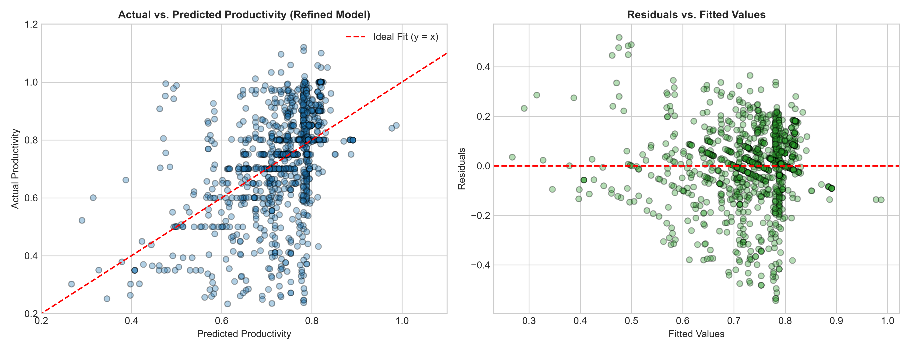
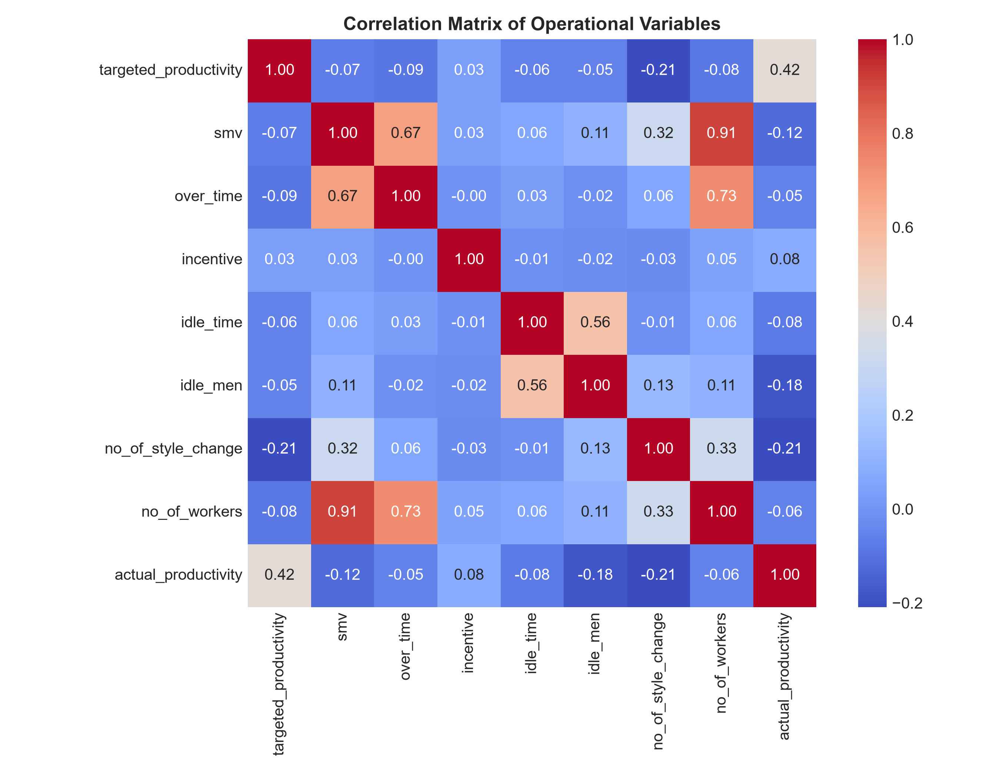

# Managerial Statistics Project: Individual Assignment

**Topic:** Predicting Garment Manufacturing Productivity: An OLS Multiple Linear Regression Approach  
**Course:** Managerial Statistics  
**Dataset:** Productivity Prediction of Garment Employees (Kaggle / UCI Machine Learning Repository)  
**Total Sample Size ($N$):** 1,197 Observations  
**Submission Date:** November 6, 2026  
  
**Name:** Abhinav Thaivalappil  
**Roll No:** AM.SC.U4CSE23103  
**S7 CSE B**

---

## Executive Summary / Abstract

This project applies Ordinary Least Squares (OLS) multiple linear regression to predict garment factory worker productivity. Using operational line data from 1,197 production runs, we evaluate model significance and use backward elimination to remove non-significant factors, yielding a statistically validated, six-predictor model that optimizes plant-floor resource allocation and operational decision-making.

---

## 1. Problem Context & Model Specification

In modern apparel manufacturing, meeting production targets under tight export deadlines depends heavily on the day-to-day productivity of sewing and finishing teams. This case study develops an econometric model to assist factory line managers in estimating daily actual productivity, identifying efficiency bottlenecks, and evaluating how operational targets and incentives impact output.

### 1.1 Model Class
* **Model Type:** Ordinary Least Squares (OLS) Multiple Linear Regression.

### 1.2 Variable Definitions
* **Response / Dependent Variable ($Y$):**  
  * `actual_productivity`: Continuous efficiency ratio (observed range 0.234–1.120; 37 of the 1,197 runs exceed 1.0) calculated as standard task output achieved divided by allocated standard working hours.
* **Initial Explanatory Variables ($X_1$ to $X_8$):**
  1. $X_1$ (`targeted_productivity`): Baseline productivity benchmark assigned by factory management ($0.07 \le X_1 \le 0.80$).
  2. $X_2$ (`smv`): Standard Minute Value; the engineering allocated time duration (in minutes) representing the complexity of the garment style.
  3. $X_3$ (`over_time`): Total cumulative overtime clocked by the line operators (in minutes).
  4. $X_4$ (`incentive`): Monetary bonus awarded to the team based on exceeding threshold targets (in local currency BDT).
  5. $X_5$ (`idle_time`): Work minutes halted due to mechanical breakdowns or material stockouts.
  6. $X_6$ (`idle_men`): Number of workers sitting idle during line interruptions.
  7. $X_7$ (`no_of_style_change`): Count of design or cut changes introduced on a line during a production run.
  8. $X_8$ (`no_of_workers`): Total headcount deployed on that specific line.

*(Note: The variable `wip` [Work In Progress] was excluded because it contains 506 missing values — every one of the 506 finishing-department rows; excluding it prevents artificial sample attrition or imputation distortion across the 1,197 observations. The categorical fields quarter, department, day, and team were likewise excluded to keep the specification strictly to the continuous operational regressors).*

---

## 2. Requirement 1: Prediction Equation & Interpretation

### 2.1 Initial Estimated Regression Equation

Using Ordinary Least Squares estimation on the full 8-variable specification:

$$
\begin{aligned}
\widehat{\text{actual\_productivity}} = 0.2261 &+ 0.6982(X_1) - 0.0064(X_2) - 3.866 \times 10^{-6}(X_3) \\
&+ 5.238 \times 10^{-5}(X_4) + 0.0005(X_5) - 0.0091(X_6) \\
&- 0.0476(X_7) + 0.0035(X_8)
\end{aligned}
$$

### 2.2 Detailed Economic & Practical Interpretation

* **Intercept ($\beta_0 = 0.2261$):**  
  If all explanatory variables are theoretically set to zero, the model predicts a baseline output efficiency of 22.61%. While a factory line cannot operate with zero workers or zero target, this constant represents baseline residual productivity inherent in line presence and basic operational inertia.
* **Targeted Productivity ($\beta_1 = +0.6982$):**  
  Holding all other inputs constant (*ceteris paribus*), a 0.10 (10 percentage point) increase in the target set by management translates to an estimated **6.98 percentage point increase** in actual productivity. This confirms a pronounced psychological anchoring effect in goal-setting.
* **Standard Minute Value — SMV ($\beta_2 = -0.0064$):**  
  For each 1-minute increase in garment complexity, actual productivity declines by **0.64 percentage points**, controlling for other factors. Higher-complexity garments slow pacing and introduce assembly friction.
* **Overtime ($\beta_3 = -0.00000387$):**  
  Each additional overtime minute has an almost imperceptible and slightly negative marginal association, pointing to potential operator fatigue over prolonged shifts.
* **Incentive ($\beta_4 = +0.0000524$):**  
  For every 1,000 BDT paid in financial performance incentives, the model estimates a 5.24 percentage point increase. This coefficient is, however, not statistically significant in the full model ($p = 0.058$), so the positive sign is suggestive rather than confirmed; it attains statistical significance ($p = 0.041$) only in the refined model of Section 5.
* **Idle Time ($\beta_5 = +0.0005$):**  
  Shows an unexpected near-zero positive coefficient, primarily driven by severe zero-inflation (very few runs recorded stoppage, creating estimation noise).
* **Idle Men ($\beta_6 = -0.0091$):**  
  Every additional idle worker on the floor reduces line productivity by **0.91 percentage points** due to line balance disruption and bottleneck cascading.
* **Style Changes ($\beta_7 = -0.0476$):**  
  Each style change incurs an efficiency penalty of **4.76 percentage points**. Retooling machines and retraining motor patterns creates significant operational drag.
* **Number of Workers ($\beta_8 = +0.0035$):**  
  Each additional team member increases efficiency by **0.35 percentage points**, indicating positive returns from division of labor up to the observed team size.

---

## 3. Requirement 2: Significance of the Regression as a Whole

To evaluate whether the combined set of 8 operational predictors explains a statistically significant portion of variation in employee productivity over a naive mean model:

### 3.1 Hypothesis Formulation
* **Null Hypothesis ($H_0$):**  
  $$
  \beta_1 = \beta_2 = \beta_3 = \beta_4 = \beta_5 = \beta_6 = \beta_7 = \beta_8 = 0
  $$
  *(None of the explanatory variables linearly predict actual productivity; the model has no explanatory power).*
* **Alternative Hypothesis ($H_a$):**  
  $$
  \text{At least one } \beta_j \neq 0 \quad (\text{for } j \in \{1, 2, \dots, 8\})
  $$

### 3.2 Statistical Results & Inference
* **Degrees of Freedom:** $\text{Model } df = 8$, $\text{Residual } df = 1,188$
* **Overall $F$-Statistic:** $49.08$
* **$p$-Value ($\text{Prob} > F$):** $1.20 \times 10^{-68}$
* **Inference:**  
  Because the $p$-value ($1.20 \times 10^{-68}$) is overwhelmingly below the standard threshold ($\alpha = 0.05$), we **decisively reject $H_0$**. The regression model as an integrated system possesses statistically significant predictive capacity at the 99.9% confidence level.
* **Coefficient of Determination ($R^2$ & Adjusted $R^2$):**  
  * $R^2 = 0.2484$: The 8 explanatory variables account for **24.84%** of the total variance in garment worker productivity.
  * $\text{Adjusted } R^2 = 0.2433$: Penalizing for model size, the adjusted fit remains strong. In labor-intensive manufacturing environments where human fatigue, ambient floor conditions, and interpersonal dynamics are unobserved, an $R^2$ of ~25% with an $F$-test significance below $10^{-68}$ confirms a robust baseline model.

---

## 4. Requirement 3: Significance of Each Individual Variable

To evaluate the marginal contribution of each predictor when controlling for all others, two-tailed hypothesis tests were conducted:
$$
H_0: \beta_j = 0 \quad \text{vs.} \quad H_a: \beta_j \neq 0 \quad (\alpha = 0.05)
$$

### 4.1 Parameter Estimates & $t$-Test Summary

| Variable ($X_j$) | Coefficient ($\beta_j$) | Standard Error | $t$-Statistic | $p$-Value ($P > \|t\|$) | 95% Confidence Interval | Conclusion ($\alpha = 0.05$) |
| :--- | :---: | :---: | :---: | :---: | :---: | :--- |
| **Intercept (`const`)** | 0.2261 | 0.035 | 6.409 | &lt; 0.001 | [0.157, 0.295] | Statistically Significant |
| **`targeted_productivity`** | 0.6982 | 0.046 | 15.110 | &lt; 0.001 | [0.608, 0.789] | **Significant** ($p < 0.001$) |
| **`smv`** | -0.0064 | 0.001 | -6.573 | &lt; 0.001 | [-0.008, -0.005] | **Significant** ($p < 0.001$) |
| **`over_time`** | -3.866e-06 | 2.05e-06 | -1.889 | **0.059** | [-7.88e-06, 1.48e-07] | **Not Significant** ($p > 0.05$) |
| **`incentive`** | 5.238e-05 | 2.76e-05 | 1.900 | **0.058** | [-1.71e-06, 1.07e-04] | **Not Significant** ($p > 0.05$) |
| **`idle_time`** | 0.0005 | 0.000 | 1.132 | **0.258** | [-0.0004, 0.0014] | **Not Significant** ($p > 0.05$) |
| **`idle_men`** | -0.0091 | 0.002 | -5.476 | &lt; 0.001 | [-0.012, -0.006] | **Significant** ($p < 0.001$) |
| **`no_of_style_change`** | -0.0476 | 0.012 | -4.067 | &lt; 0.001 | [-0.071, -0.025] | **Significant** ($p < 0.001$) |
| **`no_of_workers`** | 0.0035 | 0.001 | 6.564 | &lt; 0.001 | [0.002, 0.005] | **Significant** ($p < 0.001$) |

### 4.2 Managerial Assessment of Findings
* Five predictors (`targeted_productivity`, `smv`, `idle_men`, `no_of_style_change`, and `no_of_workers`) demonstrate strong statistical significance at $p < 0.001$.
* `idle_time` ($p = 0.258$) provides zero incremental explanatory value, indicating that tracking idle time duration without factoring in line context adds noise.
* `over_time` ($p = 0.059$) is marginally non-significant because its variance is largely absorbed by line size and task complexity: it correlates with `no_of_workers` ($r = 0.73$) and `smv` ($r = 0.68$), while its correlation with `incentive` is negligible ($r = -0.005$). Its removal in Section 5 releases the suppression on `incentive`, whose significance then emerges ($p=0.041$).

---

## 5. Requirement 4: Model Modification & The Better Regression Equation

### 5.1 Optimization Procedure: Backward Elimination
To eliminate superfluous predictors, reduce multicollinearity, and achieve managerial parsimony, an iterative **Backward Elimination** procedure was executed using a standard significance threshold ($\alpha_{\text{out}} = 0.05$):

1. **Step 1:** In the full model, `idle_time` displayed the highest non-significant $p$-value ($p = 0.2578 > 0.05$) and was removed first.
2. **Step 2:** Upon re-estimating the 7-variable model, `over_time` remained statistically non-significant ($p = 0.0657 > 0.05$) and was dropped.
3. **Step 3:** In the resulting 6-variable model, `incentive` became statistically significant at the 5% level ($p = 0.041 < 0.05$), as the suppression effect from `over_time` was eliminated. All remaining regressors achieved $p < 0.05$.

---

### 5.2 The Modified (Better) Regression Equation

$$
\begin{aligned}
\widehat{\text{actual\_productivity}}_{\text{refined}} = 0.2189 &+ 0.7043(\text{targeted\_productivity}) - 0.0065(\text{smv}) \\
&+ 5.624 \times 10^{-5}(\text{incentive}) - 0.0077(\text{idle\_men}) \\
&- 0.0427(\text{no\_of\_style\_change}) + 0.0031(\text{no\_of\_workers})
\end{aligned}
$$

---

### 5.3 Comparative Model Evaluation

| Evaluation Metric | Initial Full Model | Refined (Better) Model | Relative Change / Impact |
| :--- | :---: | :---: | :--- |
| **Predictor Count ($k$)** | 8 | **6** | **$-2$ variables** (Simpler operational tracking) |
| **$R$-Squared ($R^2$)** | $0.2484$ | $0.2454$ | Minor decrease of $0.003$ ($0.3\%$) |
| **Adjusted $R$-Squared** | $0.2433$ | $0.2416$ | Preserved; penalization reflects genuine signal |
| **Overall $F$-Statistic** | $49.08$ | **$64.51$** | **Increased by $+31.4\%$** (Enhanced signal-to-noise ratio) |
| **Prob ($F$-Statistic)** | $1.20 \times 10^{-68}$ | **$1.84 \times 10^{-69}$** | Greater collective confidence |
| **Akaike Info Criterion (AIC)** | $-1107.53$ | $-1106.83$ | Essentially unchanged ($\Delta \text{AIC} = 0.70$) |
| **Bayesian Info Criterion (BIC)** | $-1061.75$ | **$-1071.22$** | **Decreased by $9.47$ points** (Strong penalty improvement) |

### 5.4 Why the Refined Model is Superior
1. **Parsimony & Cost of Data Collection:** In a factory environment, tracking machine downtime duration (`idle_time`) accurately requires high maintenance. Removing non-significant tracking variables simplifies supervisory duties without compromising predictability.
2. **Substantial $F$-Statistic Improvement:** The $F$-statistic jumped from $49.08$ to **$64.51$**, demonstrating that the variance explained per degree of freedom is significantly higher.
3. **Information Theory Confirmation (BIC):** The Bayesian Information Criterion (which strictly penalizes model complexity for large samples) decreased by **$9.47$ points**. A decrease in BIC greater than $6.0$ is universally interpreted in statistical literature as *strong positive evidence* favoring the reduced model.
4. **Resolution of Parameter Suppression:** Dropping `over_time` allowed the motivational effect of performance bonuses (`incentive`) to emerge with statistical clarity ($p = 0.041$).

---

## 6. Diagnostic Visualizations

The statistical validity of the refined model was confirmed through residual diagnostics and correlation analysis.

### 6.1 Model Diagnostics & Residual Analysis

* **Actual vs. Predicted Productivity:** The left plot shows predictions concentrated in the 0.6–1.0 band while actual outcomes span 0.23–1.12 — a typical range-compression (regression-to-the-mean) pattern in which low performers are over-predicted and high performers under-predicted. This is expected for a model with R2≈0.25, does not bias coefficient estimates, but means predictions should be used as central estimates rather than guarantees.
* **Residuals vs. Fitted Values:** The right plot shows residuals centered on zero with no systematic curvature (supporting linearity), but the spread visibly widens at higher fitted values. Formally, the Breusch–Pagan test rejects homoskedasticity (LM =164.2, p<0.001), Jarque–Bera rejects exact residual normality (JB=179.7), and the Durbin–Watson statistic (≈1.09) indicates mild positive autocorrelation across consecutive production days. These are standard limitations for bounded, repeated-measures productivity data: coefficient estimates remain unbiased, but tests near the 5% boundary (e.g., incentive, p=0.041) warrant a heteroskedasticity-robust standard errors check.

### 6.2 Predictor Correlation Heatmap

* The correlation matrix shows most predictors are only weakly related, with one clear exception: smv and no_of_workers are highly collinear (r = 0.91$; VIFs of 5.98 and 7.44), and `over_time` also tracks line size ($r = 0.73 with no_of_workers), so their coefficients are partial effects within a correlated system. By contrast, over_time and incentive are essentially uncorrelated (r=−0.00), so their marginal non-significance in Table 4.1 is not a collinearity artifact between the two.

---

## 7. Managerial Recommendations & Conclusions

Based on the verified parameters of the final regression equation, operations managers should adopt three concrete policies:

1. **Leverage Target Setting as a Primary Anchor:** Because `targeted_productivity` exhibits the highest standardized sensitivity ($\beta = +0.7043$, $t = 15.32$), establishing realistic yet ambitious benchmark targets directly pulls line performance upward.
2. **Minimize Mid-Run Style Changes:** Retooling a line for a new garment style introduces an average immediate penalty of $-4.27\%$ per change. Production planners should batch similar styles together to reduce line switches.
3. **Prioritize Idle Headcount over Overtime Extensions:** Each idle operator degrades performance by $0.77\%$. Instead of compensating for delays through expensive overtime (which showed no statistically significant productivity gain), management should focus on cross-training operators to immediately plug bottlenecks during line disruptions.

---

## 8. Submission Artifacts

All accompanying materials for this project are organized in the project repository:
* **Python Implementation Script:** `src/regression_analysis.py`
* **Raw Kaggle Dataset:** `data/garments_worker_productivity.csv`
* **Diagnostic Figures:**
  * Residuals vs. Fitted Values: `report/figures/model_diagnostics.png`
  * Variable Correlation Heatmap: `report/figures/correlation_heatmap.png`